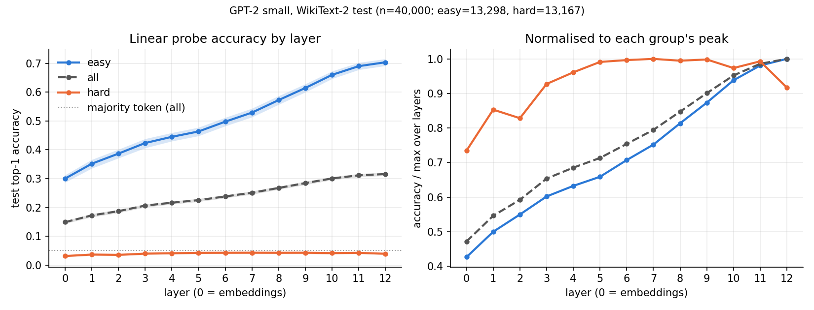

# Layer-wise linear probes for next-token prediction in GPT-2

A small empirical study of how much next-token information can be read out of each layer of a frozen GPT-2 small, using one linear probe per layer, and how that differs between positions GPT-2 finds easy and positions it finds hard.

[](https://colab.research.google.com/github/Shantanu-Das/gpt2-layerwise-analysis/blob/main/project.ipynb)

## Research question
1. How does next-token information that a linear probe can decode vary across GPT-2's layers?
2. How does that pattern differ between positions where GPT-2's own prediction is easy and where it is hard?

## Key result
Held-out top-1 accuracy of the linear probe rises at every layer, from **14.9%** at the embedding output (layer 0) to **31.6%** at the final layer (layer 12). Almost all of the gain comes from easy positions (30.0% → 70.4%). Hard positions stay at 3–4.5% at every layer.



*Left: test accuracy per layer with 95% article-level bootstrap CIs. Right: each curve divided by its own peak. For the hard group, this stretches a range of about one percentage point.*

## Setup
- **Model:** GPT-2 small (`openai-community/gpt2`, 124M parameters), frozen. Probed representations are the embedding output (layer 0) and the output of each of the 12 blocks; layer 12 is taken after the final LayerNorm.
- **Data:** WikiText-2 raw (`Salesforce/wikitext`). The articles are split into train / val / test (522 / 74 / 150) before any examples are built. From non-overlapping 256-token windows I sampled 200,000 train, 20,000 val and 40,000 test positions (t = 32…254).
- **Task:** the hidden state at position t predicts the token at t+1. The notebook checks this alignment directly.
- **Difficulty:** GPT-2's own negative log-probability of the true next token. The tertile thresholds come from the training split (easy ≤ 1.63 nats, hard > 4.38 nats) and are applied unchanged to test. Test group sizes: easy 13,298, medium 13,535, hard 13,167.
- **Probes:** one full-vocabulary linear classifier (768 → 50,257) per layer, trained on standardised features with AdamW.
  - The learning rate (3e-4) was chosen by validation loss on layer 6 and used for every layer.
  - Early stopping on validation loss, at most 10 epochs.
  - Every layer uses the same training examples, test examples and procedure.
- **Evaluation:** test top-1 accuracy and cross-entropy. The 95% CIs come from 1,000 bootstrap resamples of test articles.

## Findings
| | layer 0 | layer 6 | layer 12 | GPT-2's own top-1 |
|---|---|---|---|---|
| all | 14.9% | 23.8% | 31.6% | 35.4% |
| easy | 30.0% | 49.8% | 70.4% | 92.1% |
| hard | 3.2% | 4.3% | 3.9% | 0.0% (0 of 13,167) |

- In GPT-2 small on this data, the next token becomes more linearly decodable with depth, and the curve has no intermediate peak.
- The gain is concentrated in positions GPT-2 predicts well.
- For hard positions, top-1 accuracy barely moves. A small rise up to about layer 5 lies outside the CIs; the dip at layer 12 does not. Probe cross-entropy on hard tokens still falls steadily (9.74 → 8.39 nats).
- GPT-2 got none of the hard positions right. This is an observed result, not one the definition forces: on 55 hard positions GPT-2's top token itself had probability below the threshold.

Full per-layer numbers are in [`results/layerwise_accuracy.csv`](results/layerwise_accuracy.csv). The short report is in [`results.md`](results.md).

## Limitations
- **Decodable is not the same as used.** A probe shows the information can be read out of a layer, not that GPT-2 relies on it there.
- **Difficulty and token frequency are confounded.** Hard targets are much rarer in the probe's training labels (median count 14 vs 958 for easy targets). This experiment does not separate the two.
- **Article-parsing flaw.** The article parser mistook 30 table and formula lines for titles, so a few articles were split across train and test. This affects 101 of the 40,000 test examples and could change any reported accuracy by at most about 0.3 percentage points. It was documented rather than rerun.
- **Simple probe tuning.** One learning rate (the smallest in a small grid) and a 10-epoch cap were used for every layer. That probably lowers the absolute accuracies somewhat. The overall upward trend is larger than the measured sensitivity to the learning rate, but differences of about one point are not robust.
- **Not a fair head-to-head.** GPT-2's own accuracy is a reference point. Its output layer was trained on its full pretraining corpus, while each probe saw 200,000 WikiText positions.
- **Narrow scope:** one model, one dataset, one probe seed.

## Reproduce
The full experiment was run once, top to bottom, on a Google Colab T4 GPU. It took about 40 minutes. Versions in that run: Python 3.13.15, torch 2.11.0+cu130, transformers 5.20.1, huggingface_hub 1.33.0. The other packages were Colab's defaults at the time. A fresh reproduction from this repository has not been tested.


```bash
pip install -r requirements.txt jupyter
```

```bash
jupyter nbconvert --to notebook --execute project.ipynb --output project.ipynb --ExecutePreprocessor.timeout=-1
```

The model and data download from the Hugging Face Hub at pinned revisions. The notebook writes `results.csv`, `main_figure.png` and `metadata.json` to the working directory; this repository stores the same files, unchanged, under `results/`. Probe outputs are cached in `cache/`, keyed by a hash of the configuration.